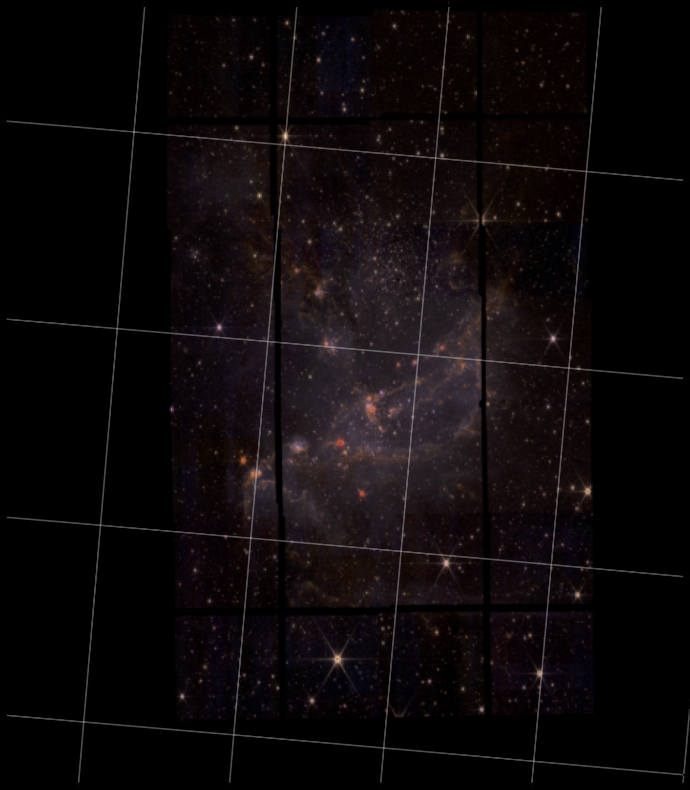

<h1 align="center">MSC thesis research project </h1>

Analysis & Methods for the calibration of a relation between Paα and Brα line emission and the accreteion luminoscity of Pre-Main-Sequence (PMS) stars in NGC 346.
Future directions : Impact from environs on the states of, mainly, class II YSO objects

<h2 align="center">RGB mosaic </h2>

  

